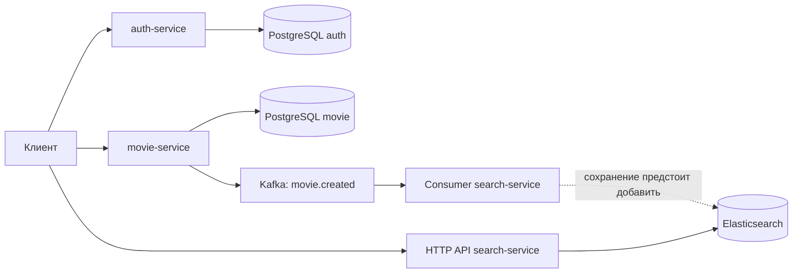

# CinemaSearch

Учебный проект для знакомства с микросервисами, Apache Kafka и Elasticsearch. Сервисы отвечают за авторизацию, каталог фильмов и поисковую копию каталога. Проект развивается небольшими шагами; интеграция Kafka → Elasticsearch пока не завершена.

## Архитектура и текущий статус



`auth-service` выдаёт JWT. Для создания режиссёров и фильмов клиент передаёт этот токен в `movie-service`. PostgreSQL хранит исходные данные каталога; Elasticsearch должен содержать документы, построенные из событий Kafka.

| Компонент | Реализовано | Следующий шаг |
| --- | --- | --- |
| auth-service | Регистрация, вход, хеширование паролей и выдача JWT | Доработка обработки конфликтов регистрации |
| movie-service | Создание и чтение фильмов и режиссёров, публикация `movie.created` | Надёжная доставка события после сохранения в БД |
| search-service: HTTP API | Подготовка индекса и получение документа по ID | Полнотекстовый поиск по названию |
| search-service: consumer | Чтение события, проверка схемы, вывод в лог | Сохранение документа и подтверждение обработки Kafka |

**Сейчас `docker compose up` запускает HTTP API search-service, но не consumer.** Даже при ручном запуске текущий consumer только выводит события в лог. Автоматическое появление новых фильмов в Elasticsearch — ближайший этап разработки.

Стек: Python 3.12 в контейнерах, FastAPI, Pydantic, SQLAlchemy Async, Alembic, PostgreSQL 17, Apache Kafka, aiokafka, Elasticsearch 8.13.4. Зависимости контейнеров перечислены в `requirements.txt` каждого сервиса; корневой файл предназначен для общего локального окружения разработки.

## Локальный запуск

Нужны Git и работающий Docker с Docker Compose V2. Все команды ниже выполняются из корня репозитория. Для запуска через Docker локальные Python и `.venv` не нужны.

### 1. Настроить окружение

В PowerShell скопировать пример, если собственного `.env` ещё нет:

```powershell
Copy-Item .env.example .env
```

В Linux/macOS аналогичная команда — `cp .env.example .env`.

Отредактировать `.env`:

- Задать свои `POSTGRES_USER` и `POSTGRES_PASSWORD`; использовать те же значения в `AUTH_DATABASE_URL` и `MOVIE_DATABASE_URL`. Имена баз в URL должны совпадать с `AUTH_POSTGRES_DB` и `MOVIE_POSTGRES_DB`.
- **Установить одинаковое значение `AUTH_SECRET_KEY` и `MOVIE_SECRET_KEY`.** В `.env.example` стоят разные заглушки. Текущая реализация использует HS256: movie-service проверяет подпись ключом, которым auth-service подписал JWT.
- Для запуска в Docker оставить `SEARCH_URL=http://elasticsearch:9200` и адреса Kafka `kafka:29092`.
- Оставить `SEARCH_INDEX=movies` и постоянный `SEARCH_KAFKA_GROUP_ID=search-service` для основного consumer.

В Docker адресом PostgreSQL служит имя Compose-сервиса `postgres-auth:5432` или `postgres-movie:5432`; пример использует заданные в Compose имена контейнеров `auth-postgres` и `movie-postgres`. `localhost` внутри контейнера указывает на сам контейнер.

Настоящий `.env` исключён из Git. В репозитории хранится только пример конфигурации.

### 2. Собрать и запустить сервисы

```sh
docker compose config --quiet
docker compose up -d --build
docker compose ps
```

Дождаться готовности PostgreSQL, Kafka и Elasticsearch и запуска трёх приложений. При проблемах посмотреть логи:

```sh
docker compose logs --tail=100 auth-service movie-service search-service kafka elasticsearch
```

### 3. Применить миграции

На новой базе таблицы ещё не созданы. После запуска контейнеров выполнить:

```sh
docker compose exec auth-service alembic upgrade head
docker compose exec movie-service alembic upgrade head
```

Эти команды также применяют новые миграции при дальнейшей разработке. Dockerfile запускает Uvicorn, поэтому миграции выполняются отдельно, до первых запросов к БД.

### 4. Открыть API

| Компонент | Адрес с компьютера |
| --- | --- |
| Auth Swagger UI | [localhost:8001/docs](http://localhost:8001/docs) |
| Movie Swagger UI | [localhost:8002/docs](http://localhost:8002/docs) |
| Search Swagger UI | [localhost:8003/docs](http://localhost:8003/docs) |
| Elasticsearch | [localhost:9200](http://localhost:9200) |
| PostgreSQL auth | `localhost:5432` |
| PostgreSQL movie | `localhost:5433` |
| Kafka | `localhost:9092` |

Порты из таблицы должны быть свободны. Текущий Compose предназначен для локальных экспериментов: в Elasticsearch отключена аутентификация.

## Проверка базового сценария

1. В Auth Swagger вызвать `POST /auth/register`. Указать уникальные имя и email; длина имени — 4–12 символов, пароля — 8–64.
2. Вызвать `POST /auth/login` с теми же email и паролем. Скопировать `access_token`.
3. В Movie Swagger нажать **Authorize** и вставить значение токена. Схема HTTP Bearer добавит префикс автоматически.
4. Создать режиссёра через `POST /directors/`, передав поле `name`. Запомнить ID из ответа.
5. Создать фильм через `POST /movies/`: указать уникальное `title`, полученный `director_id` и пустой список `genre_ids`. Запомнить ID фильма.
6. Проверить фильм через `GET /movies/`. При успешном завершении создания movie-service также отправляет событие в Kafka, в топик `movie.created`.

Получение `GET /search/{id}/` сейчас работает для документов, уже записанных в Elasticsearch. Фильм, созданный только через Movie API, ещё не обязан там находиться: consumer предстоит дополнить сохранением.

## Ручной запуск consumer

После запуска стека открыть второй терминал и выполнить:

```sh
docker compose run --rm --no-deps search-service python -m app.consumers
```

Команда создаёт отдельный контейнер из образа search-service, передаёт ему настройки сервиса и запускает модуль consumer вместо Uvicorn. Дополнительный HTTP-порт не публикуется. Kafka и Elasticsearch должны быть уже запущены: `--no-deps` не поднимает зависимости. Поведение команды описано в [документации Docker Compose](https://docs.docker.com/reference/cli/docker/compose/run/).

Создать ещё один фильм и проверить появление его ID в логах consumer. Остановить foreground-процесс можно через `Ctrl+C`.

**Текущая версия consumer не сохраняет фильм и не фиксирует offset.** Consumer — отдельный процесс search-service; новый бизнес-сервис для него не требуется.

После изменения исходников search-service пересобрать его образ перед следующим запуском worker:

```sh
docker compose build search-service
```

Исходники копируются в образ при сборке; автоматического подхвата изменений с компьютера нет.

## Остановка и ограничения текущей версии

Остановить запущенные вручную consumer, затем стек:

```sh
docker compose down
```

Без флага `-v` именованные тома PostgreSQL и Elasticsearch сохраняются. У Kafka в текущем Compose отдельный том не настроен: пересоздание её контейнера может удалить события и сохранённые offsets. Для упражнений на повторную обработку перезапускать только consumer, сохраняя брокер.

- Запись фильма в PostgreSQL и отправка события Kafka выполняются последовательно. При ошибке отправки фильм может остаться в БД без события. Transactional outbox — дальнейший этап.
- Search API пока получает документ по ID; полнотекстового поиска нет.
- Обновление и удаление поисковых документов пока не реализованы.
- Образ Kafka использует тег `latest`; фиксация версии остаётся задачей для воспроизводимости окружения.
